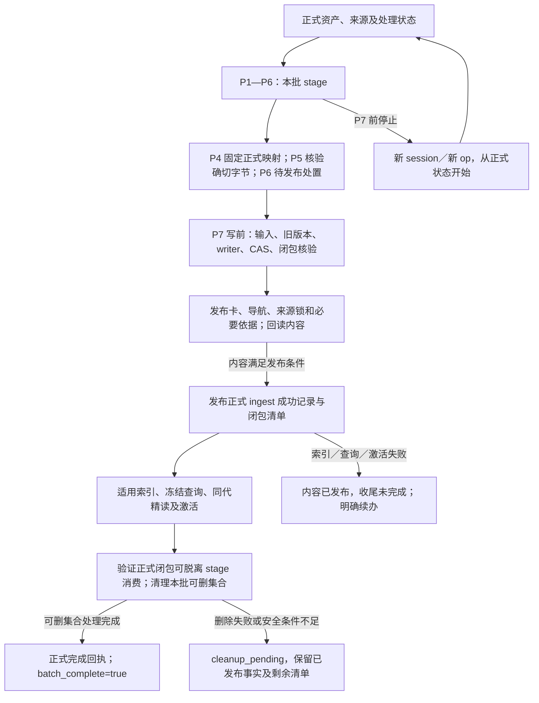

# 入库暂存与发布重构：设计

状态：**待评审，未实施**。日期：2026-10-29。本文对应[需求 R01—R16](sdd-ingest-staging-requirements.md)，实施与验证分别见[任务](sdd-ingest-staging-tasks.md)、[验证计划](sdd-ingest-staging-validation.md)。路径以 `repo/` 为项目根，K 为 `config.yml` 声明的实际知识根，不要求 K 位于固定目录。

本轮只设计和发布这套 SDD。下面的目录、字段用途和公共模块均为目标方案，不表示源码、已安装能力、正式资产或运行目录已经迁移。

## 1. 设计目标与边界

P1—P6 在 `K/.build/operations/<op>/` 内形成一次明确的工作集。P7 将经过检查的内容、正式处置和长期必要依据发布到正式位置，完成适用的本机索引、查询验证及激活后，清理本批明确拥有且不再需要的暂存。

本方案沿用九个 Skill、七个 ingest 节点及 P5 独立 reviewer，不把清理拆成新的必经节点，也不将 maintain 加进入库收尾。来源四字段、`sources[].code_ref`、Claim.source_refs 和正式处理记录 2.0 的业务含义保持。

对应使用场景：

1. 作为入库使用者，我希望 P1—P6 被停止时正式库不变，以便新 session 用新 operation 重新开始。
2. 作为同一 Workflow 的作者，我希望明确引用前序材料返工，以便继续使用本次已经读过的确切证据。
3. 作为 reviewer，我希望稿件和来源引用在检查后保持原字节，以便发布的是实际检查过的内容。
4. 作为知识消费者，我希望在生产者暂存清理后仍能取得确切原版和旧卡，以便查询与正式核验有依据。
5. 作为提交者，我希望清理后仍能核对正式文件及 Git 对象，以便提交不依赖旧 draft view。
6. 作为运维使用者，我希望区分内容发布、检索收尾和清理结果，以便失败时不重复写卡或丢失真实成功事实。

本轮不实现 P7 多文件写入中断后的自动修复、全局 GC、索引代回收、在线回收租约或废弃 Workflow 定期清理。保留 writer、CAS、单文件完整替换、journal、备份及实际回读保护；这些保护不等于跨文件原子事务。

## 2. 从当前源码到目标方案

当前依赖不能仅靠改一个目录常量消除。主要连接点如下，文件路径均相对 `repo/`。

| 当前连接点 | 已有行为 | 本次配套调整 |
|---|---|---|
| `governance/contracts/source_operations.py`，位于 K | capture 提前写 `logs/evidence` 的对象、提取与定位；raw capture 可提前登记维护事件 | 捕获字节、派生物与拟登记事件只写本批 stage；来源声明预先使用正式地址，解析经明确暂存映射取得字节 |
| `governance/contracts/source_materials.py`，位于 K | 捕获子操作使用独立 operation 目录；备料保存旧卡和旧原版 | 子任务归入同一 `<op>` 的命名子目录；明确采用的前序工件可读但不归本批所有 |
| `governance/contracts/production.py`、`input_snapshot.py`，位于 K | 完整 view 和快照直接绑定 material、bundle、draft 及其物理路径 | P4 同时冻结发布映射与正式投影身份；临时输入绑定只服务本次检查和写前复验 |
| `governance/contracts/code_review.py`，位于 K | 代码核验可写 `logs/evidence/checked-code` 和 `logs/operations` | P5 核验副本、context 和报告归本批 stage；仅长期资格确实需要的事实进入发布闭包 |
| `skills/common/knowledge/hs-knowledge-source-scan/scripts/scan.py` | 普通 scan 发现旧 inventory、batch 和 journal 停点 | 普通 scan 仅原件、正式 ingest 状态与当前维护观察；不调度旧 Workflow |
| `skills/common/knowledge/hs-knowledge-apply/scripts/transaction*.py` | journal、备份和 apply-result 使用 `logs/operations` | 新事务暂存迁到 `.build/operations/<op>/transaction/`，保留原安全协议；旧协议走明确兼容入口 |
| `governance/contracts/ingest_execution.py`、`submission.py`，位于 K | P7 收尾和提交核验仍调用 checked_view，读取旧输入快照及 draft | 发布后的收尾、完成结果和提交核验改读正式闭包清单与实际文件；不得只删 stage 而保留此硬依赖 |
| `governance/contracts/index_runtime.py`、query/来源核验，位于 K | 活动代、writer barrier、资格和材料校验各有输入链 | 保留实际索引与活跃写入安全；迁移 producer 私有证据依赖，不能要求消费者持有原机 stage |
| 根 `.gitignore`、Schema、受锁加载器和运行锁 | 四类 evidence 缓存及 operation 历史被忽略 | 新正式证据与发布清单使用可提交命名空间；加载白名单、Schema、规则锁及分发同步变更 |

独立 maintain 的正式业务状态操作仍按其职责执行；这里收紧的是 ingest P1—P6，不是把全系统所有动作都改成无副作用。

## 3. 生命周期与成功语义

必须区分三个事实：

| 事实 | 达成条件 | 正常消费者如何解释 |
|---|---|---|
| 内容处置已正式发布 | 本批内容写入、必要依据落位及对应回读／内容验证完成，然后发布成功记录 | 哪个来源版本完成什么处置、关联哪些卡、还有什么欠账 |
| 本批检索收尾完成 | 本机适用 generation、冻结查询、同代读取和原 CAS 基线激活完成 | 生产端本次运行事实；不要求其他消费者具有该 generation |
| 本批限定清理完成 | 明确可删除集合处理完，保护项与残留原因已经报告 | 不表示整个 `.build` 为空，也不表示其他 operation 已清理 |

P6 不产生正式成功记录。P7 不能在卡、来源锁和必要依据尚未满足发布条件时，提前将新来源版本记成已处理。内容发布后索引失败，仍保留真实内容成功事实；不能以本机索引未就绪推翻正式处置，也不能让新 Workflow 自动再 apply 一次。

内容批的 `batch_complete: true` 要求适用检索收尾及本批限定清理完成。仅记录批不构建索引，但仍须正式保存真实 skip／defer／failed／uncovered 等处置并完成适用清理；`recorded` 不等于所有欠账已经解决。

`completion.json` 是 P7 收尾回执，可以先保存 `batch_complete: false` 的未完成状态。文件存在本身不是完成证据；只有适用收尾与限定清理完成后，才更新为真实完成状态。

下文的状态和摘要字段名是本设计使用的概念协议，实施时须在公共契约冻结点统一为实际 Schema／CLI 字段，不表示当前 CLI 已提供这些字段。清理失败的目标观测为 `published/content_applied: true`、`cleanup.status: cleanup_pending`、`batch_complete: false`；不能把已发布内容改报为未发布。

## 4. 目录与所有权

| 位置 | 保存内容 | 写入时机与保留规则 |
|---|---|---|
| `K/docs-raw/`、配置声明的真实源码 | 已落地输入原件 | ingest 只读；不因本方案转码、改写或搬走原件 |
| `K/.build/operations/<op>/sources/` | 本批捕获对象、提取、定位和子任务输出 | P1—P6 暂存；不派生其他顶层 operation 来逃逸本批边界 |
| `K/.build/operations/<op>/materials/`、`drafts/`、`reviews/` 等本批子目录 | 材料、旧卡副本、完整稿、context、检查报告、拟登记事件、待发布处理记录 | 仅本批生成；具体叶文件名可沿现有协议迁移，但均留在 `<op>` 内 |
| `K/.build/operations/<op>/publication-plan.json` | stage→final 映射、正式投影摘要、写删集合与所有权 | 最迟 P4 固定，P5 检查；不作为长期正式依据 |
| `K/.build/operations/<op>/transaction/` | 本批 journal、备份、写入意图与未完成收尾事实 | P7 使用，未完成／结果不明不删 |
| `K/.build/runtime/writer.lock` | 跨 apply／索引激活共用的运行锁 | 固定运行位置，不属于任何本批清理集合 |
| `K/knowledge/`、`K/governance/sources.lock.yaml` | 正式卡、导航及来源登记 | P7 发布冻结字节；后续修改另起正式修订 |
| `K/logs/ingest/<op>.yaml`、`K/logs/events/` | 正式来源处置、采用版本、欠账及必要业务限制事件 | 仅 P7 达到相应发布条件后写入；独立 maintain 的明确正式动作保留原职责 |
| `K/logs/evidence/published/` | 长期必要、按固定 hash 寻址的原版、旧卡、提取／定位及构建／运行依据 | P7 发布；不属于四类可丢弃缓存，不在本批 stage 清理范围 |
| `K/logs/publications/<op>/manifest.json` | 本批正式业务闭包清单 | 内容验证后发布，消费和提交核验可直接读取 |
| `K/logs/publications/<op>/completion.json` | P7 收尾及完成回执 | 清理前保存真实已完成阶段和本批清理清单，仍为未完成；限定清理后更新完成状态，不把本机 generation 的存在变成共享入库基线 |
| `K/artifacts/indexes/` 及现有本机查询回执位置 | generation、活动指针、激活与检索运行材料 | P7 或独立索引／查询动作生成；本轮不清索引代和保留回执 |
| 本批最终 CLI 输出 | 小型结果回执，指向正式发布清单／完成回执 | 可以在清理后重新写入 `.build/operations/<op>/`，不能据目录重新出现认定清理失败 |

新正式证据建议按对象类别使用 `published/objects/<sha256>.bin`、`published/cards/<sha256>.md`、`published/extractions/<sha256>.txt`、`published/locators/<sha256>.json` 等确定地址；必要 build/runtime 对象也用固定 hash。相同目标已存在时必须核字节、hash 和大小，相符可复用，不符即完整性冲突。

`logs/publications/` 不放入 `logs/ingest/`，避免现有 ingest-record 枚举把其他类型的 manifest／回执当作处理记录。新 `logs/evidence/published/` 不复用当前被忽略的 `objects/checked-code/extractions/locators` 缓存路径。可提交规则须显式覆盖新正式命名空间，继续排除 stage、事务和测试产物。

## 5. stage→final 映射与冻结

### 5.1 从捕获时就确定正式身份

新来源在 P2 捕获后，依据实际字节 hash 为长期必要对象确定正式地址。来源 bundle 中的正式恢复地址、提取引用和 locator map 地址从此使用最终地址；真实字节先放 stage。本次明确的暂存映射负责把这些正式地址映到物理暂存位置，不能把尚未落位解释为已经发布。

若来源的同一冻结 snapshot 已正式登记，则复用该登记对象，保留其 recovery／extraction 等原字段。不能为了迁移存储地址换写旧 snapshot；本批映射与正式 published 的固定 hash 恢复承担物理位置变化。捕获／合并阶段必须在 P5 前完成该一致性判断，不能在 P7 再改登记。

每项映射至少表达：对象类别、逻辑来源／快照或卡身份、`stage_ref`、`final_ref`、`sha256`、`bytes`、本批所有权与保留原因。正文／来源登记里的引用和暂存定位是两层信息：前者是正式业务声明，后者只服务本次执行。

公共来源解析增加明确的本次绑定上下文：先用调用方实际采用的 mapping 取得对应 stage 字节，否则按正式来源恢复。必须核映射摘要、来源身份、hash、大小和路径范围，不搜索“最近一次”capture 或其他 operation。P5 的固定检查沿相同绑定核验新来源和证据；P5 不把文件复制到正式 evidence 目录。

P2 子捕获使用 `<op>/sources/<capture-id>/` 等同批子路径。子任务标识只用于本批去重，不能变成另一个顶层 operation 的隐式依赖。独立 capture 也先产生自己的明确 stage，不凭 Workflow 身份标志获得提前写正式状态的例外。

### 5.2 三种摘要不混用

| 摘要 | 绑定内容 | 用途 |
|---|---|---|
| `publication_plan_digest` | 本次 stage→final 映射、所有权及本批执行输入 | P4／P5 固定本批计划，P7 写前重验；包含暂存路径 |
| `content_digest` | 正式路径、对象身份、最终 hash／大小、受管写删及采用的来源／卡版本 | 发布后的业务身份，不包含 producer stage 路径或本机索引存在性 |
| `manifest_digest` | 正式 manifest 的完整封存内容 | 校验发布清单；完整清单可再包含内容验证后的执行事实 |

所有经过检查的 payload 满足 **stage 字节 hash = final 字节 hash**。P7 不重新 materialize 卡、不替换来源路径、不刷新旧 locator，不在发布时转换编码或重新序列化来源锁。若映射或被检查字节需要改变，必须回到对应 P2／P3／P4 并重新 P5。

P7 产生的真实执行事实另封存：例如落位观察、正式 record 的实际 applied 状态与最终完成回执。它们不得改写 P5 冻结的卡、来源、条件或作者处置。P6 的待发布 record 是处置提案；P7 在内容满足条件后添加实际执行事实形成正式记录，不把“执行事实新增”混同于“发布时改稿”。

因此，逐字节相同的映射针对原样发布的卡、来源锁和依据等 payload；P6 处置提案、拟事件和最终执行回执不作为“原样移动”项。P7 分别核其冻结输入及实际执行事实，并在正式清单登记新生成记录的最终摘要。

`content_digest` 绑定 P5 冻结的正式业务 payload 与处置语义，排除 P7 后生成的执行事实记录、manifest 自身、completion 和清理状态，避免正式 record 引用该摘要时形成自循环。正式 ingest record 可关联 `publication_ref` 与这个稳定摘要；manifest 再登记该正式 record 的实际 hash。

manifest 不把自身或后出的 completion 文件 hash 列入自己的内容。提交核验按确定路径读取这些发布文件，分别核自身封存、相互绑定及实际字节；完整提交文件清单在读取后组合，不反写成回执对自身 hash 的依赖。具体字段必须在记录 Schema 的兼容扩展中明确；保持记录 2.0 及原字段含义，不批量改写历史记录。

manifest 的内容描述发布后不再改写。completion 的阶段推进使用同一操作、同一内容身份和旧回执摘要的 CAS，再封存实际新状态；它不参与 `content_digest`。因此可以记录清理前后的状态变化，而不修改已检查或已发布的知识字节。

## 6. P1—P6 的阶段职责

### P1：只观察正式状态与真实来源

普通 scan 根据原件指纹、`logs/ingest/` 自包含记录、正式前序覆盖及 `maintenance.inspect_context` 的必要当前观察判断待处理范围。保留 substantive skip、defer／failed／uncovered、部分覆盖、分支冲突和当前规则复查的原有语义。

不枚举旧 `.build/operations`、事务或回归目录，不把旧 pending inventory 当作正式处理历史，不发现并调度旧 P7。兼容字段 `finalization_pending`／`historical_finalization_unknown` 可以保留空数组，但必须表达执行历史 `not_inspected`，不能说“没有旧停点”。

P1—P6 停止后，新 session 发起 fresh Workflow／新 operation，只根据正式状态判断：新增来源仍为新增，已正式处理后又变化的来源仍待处理。未发布的草稿、旧报告或拟登记事件不改变此结果。用户明确修订未变原件时仍可按明确目标进入 P2，不要求 P1 自动恢复这项修订意图。

### P2：捕获和旧版材料只进本批 stage

保留正式旧卡候选发现及按 snapshot 恢复旧原版。可从正式 published 对象、已登记原件／配置内源码或已固定 Git 原版获得确切字节；无法取得确切旧版时列缺口，不以当前新版替代。

原版副本、提取、定位、代码核验输入、context 和拟登记来源变化都只进本批 stage。当前 capture 对 `maintenance.register_source_change` 的正式写入调用需要拆开：P2 仅形成事件提案，P7 在对应内容／状态可发布时再登记。不能保留“先登记正式 pending 事件，稍后再提交卡”的旁路。

### P3／P4：作者决定与完整候选

P3 固定逐来源、卡和 Claim 的处置与冻结查询。P4 形成完整卡、导航、来源锁、必要证据映射、待发布闭包及输入快照。实际采用的原件、旧卡、配置、规则和明确前序工件继续绑定确切摘要。

同 Workflow 的返工必须传明确前序 view／material、原因和新 operation，不能覆盖旧工件，也不能按目录时间选材料。读取借用对象不赋予删除权；新生成的材料仍只放新 `<op>`。普通新 Workflow 不自动复用别的 running draft。

### P5／P6：检查冻结内容，尚不发布

P5 由独立 reviewer 对完整候选及真实材料审阅，再执行适用固定检查。公共 fixed checks 在合成视图中使用明确 stage resolver，必要临时索引也位于本批 stage，不写活动 `artifacts`。代码核验报告和 checked-code 副本不得写正式 logs；运行时自身的系统临时文件不作为本批业务对象或正式依据。

P6 机械转写既定处置，形成待发布记录。P1—P6 的响应、报告和适配器输出路径也受同一边界约束，不能通过 `--output` 指向 logs／artifacts 绕过。公开动作根据本职输入输出协议工作，不以传入 Workflow 身份或上游 passed 字段授权正式写入。

## 7. P7 发布协议

1. **固定本次输入。** 读取明确 view、P6 记录、发布计划和实际已检查字节；验证规则、映射、旧文件基线、来源／卡版本、当前输入及冻结查询没有变化。
2. **建立写入保护。** 取得 apply 与索引共用 writer，保留 CAS 和实际写入屏障。新 journal／备份在本批 `.build` 内持久保存，记录完整写删集合及恢复所需字节。writer 锁放在固定 runtime 位置，不能随批次目录删除。
3. **发布业务内容与依据。** 先安装本批卡、导航、来源锁、必要原版／旧卡／上下文与证据；按冻结映射进行单文件完整替换、旧版本核验和回读。目标对象不存在、存在同字节和存在冲突分别处理，不能静默覆盖冲突。
4. **确认内容发布条件，再保存正式成功事实。** 全部内容落位及对应验证完成后，才发布正式 ingest record、必要业务事件及 publication manifest。未满足条件不发布成功状态；不把一次单文件写入或 journal 生成当作完成。多文件间隙仍由写入保护约束，不声称实现了跨文件原子切换。
5. **完成适用检索收尾。** 从正式资产捕获新的 postwrite 基线，构建并完整验证真实 generation，执行本批原冻结查询及同代精读，按最初的 `expected_active` 激活，保留真实 null。后续不得改查询目的／预期或重设 CAS 来制造通过。
6. **切断消费对 stage 的依赖并保存收尾事实。** 使用正式闭包重新核对来源、必要资格事实和提交文件集合；确认正式 lint、query/read 及提交核验无需本次 draft／原机缓存。在删除任何暂存前，将真实内容／检索完成事实、同一内容绑定及本批清理清单保存到正式 completion 回执，保持 `batch_complete: false`；只有达到独立消费条件的 stage 条目才进入可删集合。
7. **清理并完成。** 执行第 9 节的限定清理，更新 completion 的清理结果和实际完成状态，再输出小型 CLI 结果。回执只描述真实达到的阶段，不将历史完成等同于当前文件仍未变化。

发布清单是已经验证字节的描述，不是略过写前检查的票据。P7 不重做作者和独立 reviewer 的全部内容工作，但必须检查本次执行安全及正式发布闭包。P7 的罕见部分写入中断仍保留 journal、备份和锁保护；自动诊断／修复后置，不能通过删除锁或暂存解决。

拟登记事件须在暂存阶段保留旧来源锁基线及 old→new snapshot 转换，P7 复验该转换后发布。不能在来源锁已经更新后，直接用原 register 逻辑重新寻找变化，否则可能因新 snapshot 已存在而漏掉事件。有效限制按已发布卡和实际引用重新核对：已经解决的机械来源限制按既有规则处理，未更新卡的欠账及语义／适用性限制继续保留，不能机械复制旧受影响集合或整表清空限制。此工作复用公共维护规则，不新增 maintain Workflow 节点。

## 8. 正式闭包和发布后消费

### 8.1 发布哪些信息

manifest 至少保存：operation、规则身份、`content_digest`、受管写删文件与 hash／大小、来源／快照／卡／Claim 的业务关联、必需证据对象、正式 ingest record 及其摘要、可读性和保留限制。P5 的 view 摘要可作追踪线索，但不能成为必须重新打开 view 的依赖。

正式 manifest 不包含用于重新打开 producer stage 的强制依赖。必要 context 只保留可验证的逻辑模块、配置身份、内容指纹和实际依据，不把整份含本机物理路径的中间材料直接复制成共享凭据。completion 是后续独立封存的正式回执，绑定 manifest／content 的身份；不用它的文件 hash 反向改写已发布 manifest，从而避免清理结束后重新生成内容身份。

长期保留范围按业务必要性判断，不把整个 stage 复制到 logs：

- 正式卡、导航、来源锁、真实处置、欠账和必要业务事件。
- 正式来源依赖的确切原版及附件；不能确认以后能精确取得的唯一原版必须发布，不能仅保留本机 capture 路径。
- 正式历史记录仍引用、且覆盖后将失去唯一副本的旧卡版本；按内容 hash 归档，不能只保存旧 Card ID。
- 仍有固定提取／定位要求的对象、必要上下文，以及 build/runtime 等真实资格所需依据。
- 能支持提交与消费的最小闭包和完成回执。

已在正式位置且确切可恢复的对象可复用；是否已在 Git 中必须实际核验，不能假设未来提交一定包含原件。没有被正式业务采用的候选、全量中间 diff、失败稿及不必要私人复核过程不长期发布。

若当前资格校验仍要求私有 code-check／project-context 文件，应将其必要事实投影为正式、按确切卡／来源／条件绑定的业务依据；不是把一个 passed 字段改名后长期保存。当前源码、配置、构建和运行资格的真实检查仍执行，符号能定位不代替语义支持，也不认证 reviewer 身份。

### 8.2 清理后的读取入口

| 后续动作 | 正式读取依据 | 不再强制读取 |
|---|---|---|
| 普通 scan | 正式 ingest 前序链、来源版本与欠账、当前维护观察 | producer inventory／draft／batch 历史 |
| 正式 lint／固定 CI | 当前正式卡、来源锁、published 证据、正式旧卡及明确作业输入 | 原 P5 私有报告或已删 checked_view |
| query/read 与消费者本机索引重建 | 正式内容闭包、本机当前索引与实际配置／源码／资格依据 | producer material、view、其本机 generation |
| prepare-submission／verify-submission | 正式 manifest、完成回执、实际文件／删除和明确 Git commit/blob | 旧 draft、原 apply-result 或 stage input_snapshot |
| 已完成操作状态／结果读取 | 正式 publication／completion 回执 | 已清理的原请求、稿件和临时 journal |

提交清单必须纳入新正式 published 证据和 publication 文件，排除 stage、runtime 锁、本机索引和测试产物。回执自身的封存校验与所列文件的实际 hash 均要核对。原件是否随业务仓提交继续按实际授权处理，不能由 P7 成功推导已经 Git 提交、推送或通过远端 CI。

再次读取已 completed 的原 operation，返回该次历史完成事实，不再次 apply。若请求核当前资产或当前提交，则比较现值，明确报告版本差异；历史 manifest 中的旧 hash 不应因后续合法修订变成“过去未完成”。

生产者原活动指针、generation 摘要及查询观测可以作为历史执行事实；消费者无需具备这些本机产物。消费者缺本机索引时独立重建、核验和激活，不因此重置共享来源处置或接续 producer Workflow。

## 9. 本批清理与结果

清理是 P7 的固定收尾职责，只消费本次明确拥有的条目清单，不用年龄、目录名或“位于 `.build`”推断可删。先确认长期闭包已发布，再对 stage 条目核路径、hash、大小、所有权及保留用途。

- 借用的 previous view／material 及其对象不属于本批 owned，不删除其父 operation。
- 本次明确已知被保留、仍有用途或无法确认可删的条目保留，记录原因。未知文件不因位于本批目录就自动删除。
- 不枚举全部旧 operation 推断反向引用，不引入九包租约或全局 GC；新 Workflow 默认只读正式状态，不复用别人的 running draft。
- 本轮不承诺为未声明的并发 reader 长期保留暂存路径。同一操作的并发执行仍须由宿主按公开协议协调，writer 锁不能被描述为已经排空全部 P2／P3／P4 读者。
- 可删目标必须解析在本批批准子树内，拒绝链接、junction、别名和越界；删除前再核实际条目，不能对计算目录盲目递归删除。
- 不触及其他 operation、正式资产、published 证据、runtime 锁、虚拟环境、活动／旧索引或保留回执。

清理结果区分 `deleted`、`retained` 及实际失败项。`cleanup.status: done` 表示本批**可删除集合**处理完成，可以存在有理由的受保护残留；不是整目录为空的断言。可删条目实际删除失败或必要安全条件未满足时为 `cleanup_pending`，保留发布成功事实和剩余清单，不能回滚知识或要求重新 apply。

解除删除故障后，再次调用该 operation 的 P7，只根据正式 manifest／收尾回执核对并补完剩余清理，不重复已完成的内容发布或索引构建。清理前已保存必要事实，因此部分 stage 已删除也不妨碍这一读取；对完成事实的校验仍须区分历史记录与当前资产状态。

若索引、查询和激活已经完成而仅清理未完成，明确重试同批 P7 时只重验必要正式绑定并补清理，不重新发布内容或重复 apply，也不无故重建已完成的索引。若失败发生在更早的收尾阶段，则仅续办实际缺失阶段。当前资产已被后续合法修订时，历史发布事实仍保留，当前差异另报，不能用新字节冒充原批次输入。

适用检索收尾尚未完成时不提前清理恢复所需对象。清理后 CLI 适配器可能重新创建本批目录写入小型结果 JSON；完成回执明确限定清理范围，不承诺整个 `.build` 清空。

## 10. 九个 Skill 与两条 Workflow 的边界

| Skill | 本轮职责 |
|---|---|
| explore | 说明新 Workflow、明确采用与正式消费边界；不自动搜旧任务或清理目录 |
| source-scan | P1 只正式状态与来源观察；P6 待发布记录只进 stage；明确 status 可读本次引用或正式完成回执 |
| source-prepare | 捕获／备料／提取全部在本批 stage；来源正式身份与本次物理绑定分离，不提前发正式事件 |
| change-plan | P3 保留作者决定、明确返工链和冻结查询；输出只在本批 stage |
| view-materialize | P4 冻结完整 payload、stage→final 映射、正式投影摘要和写删计划，不认证内容正确 |
| lint | P5 独立审阅与固定检查只写本批报告／核验 stage；独立 lint Workflow 仍只检查、巡检和报告，不发布 ingest 内容、不清理 |
| apply | P7 发布、真实内容回读、正式成功事实、适用索引收尾、限定清理；提交核验改用正式闭包 |
| query | 当前活动代与明确回执精读保持；正式资格和来源读取不依赖 producer stage，不替 ingest 发布或清理 |
| maintain | 保留显式正式业务状态操作及引用巡检；本轮不新增常规清理主路径，也不受 P1—P6 的 ingest 暂存规则误限 |

ingest 仍为 P1—P7，P5 为唯一 reviewer。P1 prompt 不再说“scan 自动发现旧 P7 并恢复”；明确续办是用户／宿主提供确切 operation／引用后走原协议。只读 lint Workflow 保持 check_formal、audit_references 两节点，不加入清理节点。

## 11. 兼容与升级

1. **旧正式来源不重签。** 保留原 `source_id/snapshot_id/locator`、code_ref 和旧 recovery／extraction 声明。公共恢复函数可按冻结 hash 访问确定的 `published` 对象位置，核注册身份、hash、大小及必要提取指纹；不得搜索 `.build` 或选新版替代旧版。
2. **旧私有缓存不批量搬迁。** 只有本批正式业务确实需要且实际验证过的旧原版／旧卡才进入发布闭包。已有正式输入可按原约定从当前登记位置、Git 或旧保留对象恢复；真正缺失时报告缺口，不伪造可恢复。
3. **记录 2.0 保持兼容。** 旧正式记录已自包含 inventory 的，旧 scan/view/material 引用只是追踪线索，不要求文件永久存在；确切来源、旧卡、前序链等业务完整性依赖仍须满足。新 publication 关联需兼容扩展，不迁移或重签旧记录。
4. **旧未完事务保守保留。** 新 journal／备份迁到 `.build`，旧 `logs/operations` 只由明确旧协议或必要写入安全检查读取，不成为普通来源判定输入。升级前须停止旧执行器；所有新 apply／index 激活共享同一新锁，不能让两种锁位置的执行器并发写入。
5. **升级是配套变更。** 受锁恢复、checks、记录与发布 Schema、加载路径白名单、资格校验、index/query/submission、CLI 输出约束、`.gitignore`、九包指引和 Workflow 均须同步。不能把删文件动作先上线，再等待消费者解除旧 view 硬依赖。

## 12. 风险、验证与实施顺序

| 风险 | 设计约束与需要验证的结果 |
|---|---|
| P7 改写路径导致 P5 与正式字节不同 | final refs 提前分配；逐 payload stage/final 同 SHA；任何变化回 P4／P5 |
| 提前写事件、证据或报告留下半成品 | 覆盖捕获、代码核验、子任务及输出适配器；P1—P6 前后正式路径集合及摘要不变 |
| 删掉唯一旧原版／旧卡 | 发布前计算业务闭包；清理前从正式位置独立恢复并核验，不依赖当前 stage 的成功读数 |
| 成功 record 早于内容生效 | 内容写完并验证后才发布正式成功事实；故障注入检查此前无成功记录 |
| stage 清理后提交、查询或资格核验失效 | 从正式 manifest 和证据重建所有必要输入；关闭旧 draft 路径仍能消费 |
| publication 自身摘要形成循环 | 区分 plan/content/manifest digest，完成回执作为明确后续事实，不反向改冻结 payload |
| 索引失败导致重复入库 | 内容处置与本机收尾分开；新 scan 不继承旧 stage，明确续办只补尾部 |
| 旧同名目录或并行任务被误删 | 本批 owned／可删清单、最终路径与字节复验；未知、借用和受保护对象保留 |
| 新旧 writer 锁互不约束 | 配套升级与执行排空；单文件 atomic／CAS 保护继续，跨文件自动修复不在本轮承诺 |
| 正式证据增长或越权发布 | 仅发布长期必要依据，仍核原来源授权、范围及敏感信息；无关候选和测试材料不进入闭包 |

实施依赖顺序为：先定义暂存映射及正式闭包协议，再修改 P1—P6 生成路径与解析；随后修改 P7 正式发布、成功事实和发布后消费；最后接限定清理及配套指引／分发。只有正式消费与提交核验已经解除 stage 硬依赖，才可启用删除。

验证使用现有九包公开 CLI 和固定契约边界：逐 P1—P6 停点新 session／新 op、正式闭包无 stage 消费、P7 内容与索引／清理分阶段失败、同 Workflow 明确返工、旧来源与旧记录兼容、精确文件提交核验。详细 oracle 与 R01—R16 对应关系见[验证计划](sdd-ingest-staging-validation.md)。

本设计及此前本机试验均不证明新方案已实现，也不代表宿主、远端受保护 CI、跨账号权限或硬件验收通过。
