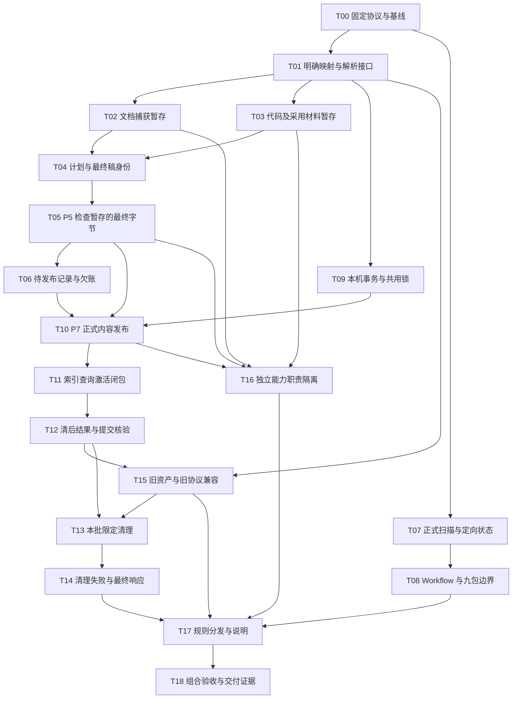

# 入库暂存与发布重构：实施任务

状态：待评审，全部任务未开始。日期：2026-10-29。

本文件属于 [SDD 总览](sdd-ingest-staging.md)，按[需求 R01—R16](sdd-ingest-staging-requirements.md)拆分实施依赖；数据协议以[设计](sdd-ingest-staging-design.md)为准，场景与证据口径见[验证计划](sdd-ingest-staging-validation.md)。本文是未来任务清单，不代表代码、Workflow、规则锁、安装副本或新验收已经改变。本次仅按授权编写并提交 SDD，不实施、不运行新方案验收、不清理运行目录。

路径以 `repo/` 为项目根，`K` 为配置声明的实际知识根；下文文件路径均相对 `repo/`。新增公共模块名 `staging.py`、`publication.py` 是设计拆分建议，实施时可以在保持公共接口和责任边界的前提下调整，不允许由某个 Skill 私有实现充当跨包规则真源。

## 1. 实施约束与顺序

- P1—P6 在 K 内生成的本批业务文件只进入 `.build/`。不提前写正式事件、正式 evidence、卡、导航、来源锁、publication 或索引状态；读取既有正式资产及声明的真实来源仍然允许。
- P2 起确定新对象的正式地址，暂存地址放在本次明确映射内。P4 固定最终物化字节，P5 检查这些字节及引用；P7 不靠事后改路径、重 seal 或忽略引用字段来替换已审内容。
- 新操作的事务和备份进入本机 `.build`；所有 writer 使用同一个稳定锁协议，锁不属于本批可清对象。旧事务不批量搬迁、改签或伪装成新协议事务。
- 正式处理记录在内容及必要依据完成发布和对应校验后才表达成功。适用索引、冻结查询和激活完成后才触发本批清理；发布状态、检索收尾与清理结果分别报告。
- cleanup done 表示本批可删集合已处理且保留项已说明，不表示目录全空；实际删除失败为 cleanup-pending，正式发布成功保持，P7 不能冒称 batch_complete。
- 清理只依据本批清单的所有权与采用关系。跨 op 明确借用的文件不属于本批 owned 集合；有保留用途或无法确认独占的文件保留并报告原因。正常自有、已发布且无采用关系的暂存可清，不扫描全局历史推断垃圾。
- 不承诺未声明的外部 reader 可以继续依赖即将清理的临时路径。不引入全局 GC、九包读租约、失败孤儿周期回收或新的用户确认门槛。
- 扩展公共协议时先保持旧正式资产可读，再迁移新 ingest 生产路径，最后移除新主链对旧暂存的依赖。每个任务附本任务的公开行为验证；最终锁定与整包验收不能代替这些检查。
- 实际执行前后记录受锁文件的版本和配套规则摘要；公开 CLI 必须使用当次正确固定的规则。T17 是最终配套核验，不表示此前可以拿陈旧锁运行 CLI，或由测试自动重 pin 来消除失败。

## 2. 任务卡

所有任务状态均为 **未开始**。依赖表示必须先满足前置任务的完成条件；不以历史测试成绩或文档存在替代完成。

### T00 固定公开协议、迁移界限与验证基线

- 需求：R01、R05、R07、R10、R11、R15、R16。依赖：无。
- 关键位置：本套 SDD；`himate-knowledge-wifi-mp/governance/specs/{sources,records,ci-runner}.md`；现有 `evals/README.md` 和各包请求／结果契约。
- 交付：按已收敛设计列明暂存对象、正式目标、映射身份、发布状态、P7 完成状态、清理结果和 tiny envelope 的含义；列明旧格式读路径及不覆盖项。记录当前真实实现和适用验收入口，不先改卡片或历史记录。
- DoD：新正式 manifest 与 evidence 路径不会落入现有 ingest-record 枚举或缓存忽略范围；P5 字节身份、正式成功发布边界、独立能力例外和保守保留规则没有相互冲突的定义；无需增加另一套用户确认或流程身份门禁。
- 验证：[V06](sdd-ingest-staging-validation.md#v06)、[V09](sdd-ingest-staging-validation.md#v09)、[V20](sdd-ingest-staging-validation.md#v20)、[V21](sdd-ingest-staging-validation.md#v21)。本任务只固定后续判据，不宣称已执行。

### T01 建立本次 stage→final 映射和双边界解析

- 需求：R01、R04、R05、R08、R15。依赖：[T00](#t00)。
- 关键位置：拟新增 `governance/contracts/staging.py`、`publication.py`；既有 `runtime.py`、`source_resources.py`、`source_operations.py`、`input_snapshot.py`，均位于 `himate-knowledge-wifi-mp/`；配套映射／publication 校验声明。
- 交付：在公共同进程接口中表达对象所有权、暂存位置、预定正式地址、确切字节身份、采用用途及保留原因；bundle 明确绑定本次映射。暂存解析只接受当前明确 bundle／映射，正式解析只使用已发布来源和声明外源，不搜索其他 op。
- DoD：未知／重复目标、越界或链接路径、映射冲突、摘要／大小不符均拒绝；不能凭路径名或某个 stage 文件存在获得来源资格。新正式引用不包含实际暂存地址；旧 snapshot、四字段来源绑定和 code_ref 的原身份不改签。
- 验证：[V05](sdd-ingest-staging-validation.md#v05)、[V06](sdd-ingest-staging-validation.md#v06)、[V07](sdd-ingest-staging-validation.md#v07)、[V20](sdd-ingest-staging-validation.md#v20)。拟新增公共映射／resolver 契约测试，不用 mock 绕过公开路径保护。

### T02 文档与附件捕获只暂存，来源变化事实先作为待发布材料

- 需求：R01、R04、R05、R13。依赖：[T01](#t01)。
- 关键位置：`himate-knowledge-wifi-mp/governance/contracts/source_operations.py`、`source_materials.py`、`maintenance.py` 的 ingest 调用边界；`skills/common/knowledge/hs-knowledge-source-prepare/scripts/entry.py` 及该包 tests。
- 交付：本批 raw／附件副本、提取文本、locator、组合 bundle 和拟登记的来源变化只写本批 `.build`；取消 ingest 捕获路径提前登记正式 `logs/events/` 的副作用。正式事件所需事实随明确材料交 P7。
- DoD：新来源和来源升级的 P2 调用均不新增或改变 `logs/evidence/`、`logs/events/`、正式锁和索引；附件完整性、原版恢复和冻结提取适配器检查保留。原件只读，实际缺材料保持缺口。
- 验证：[V01](sdd-ingest-staging-validation.md#v01)、[V02](sdd-ingest-staging-validation.md#v02)、[V06](sdd-ingest-staging-validation.md#v06)。在 source-prepare tests 断言正式路径集合及摘要前后完全一致，而不只检查返回字段。

### T03 代码、核验副本和采用的构建／运行材料进入本批暂存

- 需求：R01、R05、R06、R08、R15。依赖：[T01](#t01)。
- 关键位置：`himate-knowledge-wifi-mp/governance/contracts/source_operations.py` 的代码捕获、`source_materials.py`、`code_review.py`、`source_resources.py`；source-prepare／lint 的代码材料测试。
- 交付：本批代码对象、code-UTF8／GB18030 提取、定位及 checked-code 副本使用同一映射；采用 build／runtime 材料时固定实际来源和字节，并明确哪些需正式发布、哪些可从声明的外源精确重取。
- DoD：P7 前没有新证据写入正式日志；代码版本、模块授权、未知构建条件和原有 current／implementation 强检查不放松。不得为测试伪造源码、宏、构建或 code_ref；被采用的唯一材料不能只留下一个清理后失效的暂存 ref。
- 验证：[V01](sdd-ingest-staging-validation.md#v01)、[V06](sdd-ingest-staging-validation.md#v06)、[V07](sdd-ingest-staging-validation.md#v07)、[V08](sdd-ingest-staging-validation.md#v08)、[V11](sdd-ingest-staging-validation.md#v11)。覆盖真实字节编码及 build／runtime 材料，不将静态代码用例冒称编译或设备运行验证。

### T04 让 P3／P4 固定最终物化稿和映射身份

- 需求：R01、R04、R05、R06。依赖：[T02](#t02)、[T03](#t03)。
- 关键位置：`skills/common/knowledge/hs-knowledge-change-plan/scripts/{planning,plan_v3}.py`；`hs-knowledge-view-materialize/scripts/materialize.py`；`himate-knowledge-wifi-mp/governance/contracts/production.py`、`input_snapshot.py`、`source_materials.py`。
- 交付：完整卡／导航／来源锁／写删集合、处置预览、必要依据及明确映射在 P4 固定。输入快照区分本次私有采用记录与将来正式消费者需要的依赖；同 Workflow 明确返工继续按确切 previous-view／material 身份采用。
- DoD：P4 输出中的最终卡和新来源地址就是 P5 将检查的正式物化结果；P7 不需要再改写这些内容。新 Workflow 不选旧“最近一次”稿件；返工不覆盖旧稿，输入漂移仍明确回所需节点。旧正式 snapshot／code_ref 不因新路径方案被改写。
- 验证：[V05](sdd-ingest-staging-validation.md#v05)、[V06](sdd-ingest-staging-validation.md#v06)、[V07](sdd-ingest-staging-validation.md#v07)。同时检查字段、完整对象和摘要，不能仅忽略所有 ref 后比较正文。

### T05 P5 从明确暂存读取并检查将发布的确切内容

- 需求：R01、R04、R05、R06。依赖：[T04](#t04)。
- 关键位置：`skills/common/knowledge/hs-knowledge-lint/scripts/{lint,review}.py`；`himate-knowledge-wifi-mp/governance/contracts/{review_inputs,checks,code_review,source_resources}.py`；lint tests 和来源／code_ref 公共契约测试。
- 交付：P5 质量检查的候选来源 resolver 接入明确 bundle／映射；审阅结果绑定最终物化字节、采用版本和映射身份。本次报告、checked-code 及任何检查临时产物均留在 `.build`，不提前发布索引或正式状态。
- DoD：保留完整适用质量检查和独立审阅输入的真实绑定；正文、code_ref、映射、对象或引用被篡改均阻断。P5 后重新 seal 不能授权另一份未审稿。正式 lint 的读取边界不自动扩大到其他 op 的暂存。
- 验证：[V01](sdd-ingest-staging-validation.md#v01)、[V06](sdd-ingest-staging-validation.md#v06)、[V07](sdd-ingest-staging-validation.md#v07)、[V08](sdd-ingest-staging-validation.md#v08)。公开 review 路径覆盖文档和代码两类输入。

### T06 P6 只生成待发布记录，保持处置和正式欠账语义

- 需求：R01、R04、R07、R12、R15。依赖：[T05](#t05)。
- 关键位置：`skills/common/knowledge/hs-knowledge-source-scan/scripts/record.py`；`himate-knowledge-wifi-mp/governance/contracts/records.py`、`production.py`；`governance/specs/records.md` 和相关 record／历史上下文测试。
- 交付：P6 的记录、处置预览和新旧关联仅保存于本批 `.build`，作为 P7 的显式待发布输入。保持现有正式 2.0 的 inventory、采用版本、逐单元范围、前序摘要和欠账，不建立另一份 last-success 真源。
- DoD：P6 成功不能推进正式完成基线。substantive skip、defer、failed、uncovered、部分覆盖、多卡及窄范围后继均有独立 oracle；正式欠账不因旧草稿存在或被清理而变化。不把执行追踪型旧 ref 变成永久私有文件依赖。
- 验证：[V01](sdd-ingest-staging-validation.md#v01)、[V05](sdd-ingest-staging-validation.md#v05)、[V17](sdd-ingest-staging-validation.md#v17)、[V20](sdd-ingest-staging-validation.md#v20)。

### T07 普通 scan 只解释正式状态，status 明确区分定向和总览

- 需求：R02、R03、R09、R12、R13。依赖：[T00](#t00)。
- 关键位置：`skills/common/knowledge/hs-knowledge-source-scan/scripts/{scan,status,progress}.py`、该包 `references/request.md`、产物模板与 tests。
- 交付：普通 scan 移除旧 `.build/operations` 的 pending inventory 发现和 batch／journal／历史索引收尾发现。定向 status 只读目标固定路径及明确链；无 target 的显式 status 保留全局诊断。已发布新操作的正式结果入口在 T12 补齐。
- DoD：坏旧 inventory／draft／regression 的存在与否不改变正式增量结果；新 Workflow 不获得旧 P7 恢复建议。兼容保留的空收尾数组明确表示“执行历史未检查”。正式处置、当前必要维护判断和既有规则复查策略不放松；unknown 不猜成关联成功。
- 验证：[V02](sdd-ingest-staging-validation.md#v02)、[V03](sdd-ingest-staging-validation.md#v03)、[V04](sdd-ingest-staging-validation.md#v04)、[V13](sdd-ingest-staging-validation.md#v13)、[V17](sdd-ingest-staging-validation.md#v17)。

### T08 对齐七节点 Workflow 与九包入口边界

- 需求：R02、R03、R04、R13、R14、R16。依赖：[T07](#t07)。
- 关键位置：`workflows/common/knowledge/hs-knowledge-ingest/{workflow.yaml,README.md}`；九包 `SKILL.md` 及必要 request／产物说明；`himate-knowledge-wifi-mp/evals/{validate_design.py,tests/test_workflows.py}`；source-scan `tests/test_supported_workflow.py`。
- 交付：P1 仅 scan→prepare／unchanged，删除 recover／resume_index／resume_queries 出口。新 Workflow 新 operation；同 session 留在本次实际节点继续，同 Workflow 的 P5 返工保持明确引用。P7 本次安全停点和独立 apply 恢复能力不被删除。
- DoD：仍恰好七节点、P5 reviewer／其余 coder；不新增 maintain 清理节点。九包均明确普通读取边界，既不自动找旧私有目录，也不把必要正式来源恢复误禁为历史浏览。静态负例仍能发现非法跳步，不仅修改正例期望。
- 验证：[V02](sdd-ingest-staging-validation.md#v02)、[V04](sdd-ingest-staging-validation.md#v04)、[V05](sdd-ingest-staging-validation.md#v05)、[V19](sdd-ingest-staging-validation.md#v19)、[V21](sdd-ingest-staging-validation.md#v21)。

### T09 新事务与备份暂存化，统一稳定 writer 协议

- 需求：R01、R06、R10、R13、R15。依赖：[T01](#t01)。
- 关键位置：`skills/common/knowledge/hs-knowledge-apply/scripts/{transaction,transaction_v3,support}.py`；`himate-knowledge-wifi-mp/governance/contracts/{legacy_runtime,index_runtime,maintenance,checks}.py` 及读取事务安全状态的公共调用。
- 交付：新操作 journal、备份及私有事务结果位于 `.build/operations/<op>/transaction/` 等设计指定位置；所有协作 writer 使用设计指定的稳定锁位置与同一协议，拟为 `.build/runtime/writer.lock`。安全检查区分本机待恢复事务与正式来源处理状态。
- DoD：CAS、整文件完整替换、实际回读、备份完整性和外部编辑保护继续有效；未完／不可解释事务不能被新 Workflow 静默越过。锁不在 cleanup owned 集合。旧 journal 按兼容路径解释，不自动迁移；不宣称不同锁协议的旧新 writer 可以并行安全运行。
- 验证：[V08](sdd-ingest-staging-validation.md#v08)、[V10](sdd-ingest-staging-validation.md#v10)、[V18](sdd-ingest-staging-validation.md#v18)、[V20](sdd-ingest-staging-validation.md#v20)。

### T10 P7 发布内容、必要证据、正式处置和 publication 清单

- 需求：R05、R06、R07、R08、R12、R15。依赖：[T05](#t05)、[T06](#t06)、[T09](#t09)。
- 关键位置：`hs-knowledge-apply/scripts/{entry,transaction,transaction_v3}.py`；`himate-knowledge-wifi-mp/governance/contracts/{ingest_execution,publication,source_resources,records,maintenance}.py`；相关发布契约及 apply tests。
- 交付：P7 只发布已固定并检查的卡／导航／来源锁及必要来源对象、提取定位、唯一旧卡和采用材料。新正式 evidence 使用 `logs/evidence/published/` 内容寻址地址；正式 publication 清单使用 `logs/publications/<op>/manifest.json`，不混入 `logs/ingest/` 的枚举。正式处理记录与适用事件由 P7 在对应发布条件满足后落位。事件沿暂存的旧基线和 old→new snapshot 转换发布，不能在写后锁上重新发现变化；按已发布实际引用处理机械限制，保留未解决及语义／适用性限制。
- DoD：证据与内容完整落位、对应实际校验成功之前，不产生该新版本的正式成功处理状态；仅预制 applied、P6 通过或单卡落盘不能推进基线。记录发布、内容成功和本机检索就绪分别表达；record_only 不伪造内容或索引。P7 不重做 P5 语义工作，也不偷偷修改已审字节。罕见多文件中断保留真实状态和现有安全保护，不增加自动修复保证。
- 验证：[V06](sdd-ingest-staging-validation.md#v06)、[V07](sdd-ingest-staging-validation.md#v07)、[V08](sdd-ingest-staging-validation.md#v08)、[V09](sdd-ingest-staging-validation.md#v09)、[V10](sdd-ingest-staging-validation.md#v10)、[V17](sdd-ingest-staging-validation.md#v17)。

### T11 建立索引、资格、查询与激活的清后闭包

- 需求：R06、R08、R09、R10、R11。依赖：[T10](#t10)。
- 关键位置：`himate-knowledge-wifi-mp/governance/contracts/{ingest_execution,input_snapshot,index_runtime,query_runtime,query_regression}.py`；apply／query tests 和索引公共契约测试。
- 交付：写后索引使用已发布正式内容和实际外源；持久 generation 的 input_snapshot、qualifications、code_contexts、view／apply 绑定、regression 与 activation 执行绑定使用正式闭包或保留必要事实，不要求清理后的原 draft、私有报告或旧请求存在。
- DoD：保留完整 SQLite／正文验证、冻结查询、同代 read、原 expected_active（包括 null）和 CAS 激活。仅作追踪的 stage ref 不再触发必需回读；真正需要复验的证据必须有正式地址或明确持久外源。既有活动代、回执及有效限制不因本批清理被删改；不能靠 JSON passed 声明跳过实际校验。
- 验证：[V08](sdd-ingest-staging-validation.md#v08)、[V09](sdd-ingest-staging-validation.md#v09)、[V10](sdd-ingest-staging-validation.md#v10)、[V11](sdd-ingest-staging-validation.md#v11)、[V12](sdd-ingest-staging-validation.md#v12)。

### T12 从正式发布结果读取完成事实、重入和提交清单

- 需求：R07、R08、R09、R11、R15。依赖：[T11](#t11)。
- 关键位置：`himate-knowledge-wifi-mp/governance/contracts/{publication,ingest_execution,submission}.py`；apply `scripts/{entry,transaction}.py`；source-scan `scripts/{status,progress}.py`；提交、结果读取、status 测试。
- 交付：P7 已发布操作的结果读取、重入、prepare-submission／verify-submission 和 target status 能从明确正式 publication 及实际资产获得所需清单与绑定，不再硬读已清的 checked_view／journal／P6 私有副本。
- DoD：清后新进程可读原完成事实且不重复写卡；提交核验仍读取真实 HEAD、commit、blob、删除及精确变更范围，不以 manifest 自称成功代替 Git 检查。目标 status 不受无关坏历史影响；全局显式 status 保留诊断能力。正式记录中的 soft 追踪引用不会复活整个旧 op。
- 验证：[V11](sdd-ingest-staging-validation.md#v11)、[V12](sdd-ingest-staging-validation.md#v12)、[V13](sdd-ingest-staging-validation.md#v13)、[V20](sdd-ingest-staging-validation.md#v20)。

### T13 P7 仅清理本批明确拥有且无保留用途的暂存

- 需求：R04、R08、R09、R10、R15。依赖：[T12](#t12)、[T15](#t15)。
- 关键位置：`himate-knowledge-wifi-mp/governance/contracts/publication.py` 的限定清理、`ingest_execution.py`；apply tests，拟新增清理归属／跨 op 引用测试。
- 交付：适用内容发布及索引／查询／激活完成后，按正式 publication 清单逐项处理本批 owned 集合；区分已发布副本、无保留用途临时物、明确借用和需保留材料。清理不成为新的 maintain 主路径。
- DoD：不按目录递归猜测、不清整个 `.build`，也不删除其他 op、开发 venv、当前 helper 环境、稳定锁、正式依据或当前索引。跨 op 借用不进入 owned；明确在途采用、保留用途或无法确认独占的文件保留并解释。可删集合处理完成、保留项已说明可以形成 cleanup done；保留不伪装成删除失败，删除失败也不伪装成主动保留。未知文件不被顺带清走，不承诺保护未声明的任意外部 reader。
- 验证：[V14](sdd-ingest-staging-validation.md#v14)、[V16](sdd-ingest-staging-validation.md#v16)，并在删除本批应清集合后重新执行 [V11](sdd-ingest-staging-validation.md#v11)。

### T14 清理失败保留发布成功，支持清理重试和最终小响应

- 需求：R09、R10、R11、R13。依赖：[T13](#t13)。
- 关键位置：`himate-knowledge-wifi-mp/governance/contracts/{publication,ingest_execution,runtime}.py`；apply CLI／support 的实际输出路径；P7 故障和响应测试。
- 交付：删除任何暂存前先在正式收尾回执保存真实已完成阶段、内容绑定与清理清单；以 `batch_complete=false` 表达尚未全部收尾。持久表达 publication-success 与 cleanup-pending／剩余项／原因；后续只重试有明确清单的清理或返回已完成事实，不重新 ingest。最终 CLI envelope 可以在 `.build` 保留或在清理后生成，不能携带失效的必需私有依赖。
- DoD：注入删除失败后，正式记录、证据、活动索引和已完成发布事实保持；报告 publication-success 与 cleanup-pending，batch_complete 仍为 false，不回滚知识、不重复 apply、不把未清项报成全清。发布尚未成功时不得借清理路径补发成功。多次清理或响应读取结果可解释，tiny envelope 不被当作新业务暂存泄漏。
- 验证：[V10](sdd-ingest-staging-validation.md#v10)、[V14](sdd-ingest-staging-validation.md#v14)、[V15](sdd-ingest-staging-validation.md#v15)、[V18](sdd-ingest-staging-validation.md#v18)。

### T15 保持旧正式来源、记录和明确旧流程输入兼容

- 需求：R04、R08、R09、R15。依赖：[T01](#t01)、[T12](#t12)。
- 关键位置：`himate-knowledge-wifi-mp/governance/contracts/{source_resources,source_operations,records,publication,index_runtime}.py`；apply legacy transaction 读取；source-scan progress／status；`governance/specs/{sources,records}.md`。
- 交付：新正式 published 对象与旧 Git／登记路径／缓存恢复可区分读取；既有来源四字段、snapshot、code_ref、冻结提取信息、正式 record 2.0、旧回执及明确旧事务按各自版本解释。新 Workflow 不通过兼容层隐式采用旧私有 op。
- DoD：历史卡、来源锁及记录保持原字节／摘要，不批量重签或移动；支持范围外明确报告缺口。旧非终态事务仍受保护，使用匹配能力显式处理，不在新发布中自动修复。兼容不等于强制保留所有旧 stage，也不承诺不同版本 writer 同时部署可混用。
- 验证：[V05](sdd-ingest-staging-validation.md#v05)、[V12](sdd-ingest-staging-validation.md#v12)、[V13](sdd-ingest-staging-validation.md#v13)、[V20](sdd-ingest-staging-validation.md#v20)。

### T16 验证独立 lint、maintain 和其他公开动作不被 ingest 规则误伤

- 需求：R01、R06、R09、R14、R15。依赖：[T02](#t02)、[T03](#t03)、[T05](#t05)、[T10](#t10)。
- 关键位置：`workflows/common/knowledge/hs-knowledge-lint/workflow.yaml` 及说明；maintain／lint 的 SKILL、request 和 tests；公共 `maintenance.py`、`reference_audit.py`；独立 source-prepare、apply index／regression、query 公开动作。
- 交付：按明确业务入口区分 ingest 暂存和独立维护的合法正式写入。lint Workflow 保持 check_formal／audit_references 两节点，只检查和报告，不发布 ingest 内容或偷偷清报告；maintain 的显式 register／recover-events／advance 维持原业务职责。
- DoD：独立维护仍能保存其实际事件和限制，不能被全局“所有能力都只能写 stage”误禁；其依赖的确切材料仍可用。普通查询和独立索引不依赖生产者旧 stage；独立动作不因 ingest 新协议被迫伪造七阶段票据或进入 P7。
- 验证：[V11](sdd-ingest-staging-validation.md#v11)、[V19](sdd-ingest-staging-validation.md#v19)、[V20](sdd-ingest-staging-validation.md#v20)。

### T17 同步规则锁、分发、忽略规则及共享说明

- 需求：R14、R15、R16。依赖：[T08](#t08)、[T09](#t09)、[T14](#t14)、[T15](#t15)、[T16](#t16)。
- 关键位置：`.gitignore`；`himate-knowledge-wifi-mp/governance/framework.lock.yaml`、必要 schemas／specs、`check.py`；九包 loader／依赖／能力说明；`evals/validate_design.py`、`evals/tests/test_git_asset_boundary.py` 及分发测试；共享设计、使用说明和 README。
- 交付：受锁新公共代码和声明全部登记；核实动态 loader、可信 CI、包安装和静态产物契约能加载正确版本。新 `logs/publications/`、`logs/evidence/published/` 必要正式资产可提交，暂存／私有事务仍排除。
- DoD：不通过忽略整个 logs 丢失正式状态，也不为了发布新目录重新跟踪旧 evidence cache、测试或本机环境。按真实变更判断哪些 loader／Schema／依赖需改、哪些只需验证，不假设所有 wrapper 都要重写。更新能力源码不冒称安装副本、宿主或远端已升级。
- 验证：[V12](sdd-ingest-staging-validation.md#v12)、[V20](sdd-ingest-staging-validation.md#v20)、[V21](sdd-ingest-staging-validation.md#v21)。

### T18 完成公开链路、停点、清后消费和实际分发验收

- 需求：R01—R16。依赖：[T17](#t17)。
- 关键位置：`himate-knowledge-wifi-mp/evals/{README.md,run_acceptance.py,pipeline_harness.py,tests/}`；九包各自 tests，尤其 source-scan `test_supported_workflow.py`、领域 `test_workflows.py`、`test_clean_clone.py`；拟新增 staging／publication／cleanup 综合测试。
- 交付：按验证计划逐项保存源版本、规则／包／依赖摘要、输入身份、每阶段正式状态清单、JUnit、stdout/stderr 和可解释结果；不修改真实原件，不读取受限 gold。
- DoD：V01—V21 有实际通过或明确未完成记录。P1—P6 六个停点均用新进程／新 op、不传旧 ref 重跑；清后 fresh scan、正式 lint、query/read、status、submission 与实际 clean clone 均成立；文档、代码及 record_only 不互相替代。故障注入、真实 CLI hard stop、宿主取消、CI／设备／权限分别表述，不把未测的极端自动修复计为通过。
- 验证：[完整验证计划](sdd-ingest-staging-validation.md)。只有实际完成并记录范围后才能更新对应任务状态；本文件不预填成绩，也不授权提交、推送或安装升级。

## 3. 需求覆盖与任务索引

| 需求 | 主要任务 |
|---|---|
| R01 本批前六步只暂存 | T01、T02、T03、T04、T05、T06、T09、T18 |
| R02 普通 scan 正式输入 | T07、T08、T18 |
| R03 新 Workflow 新 op | T07、T08、T18 |
| R04 明确交接与返工 | T01、T04、T05、T06、T08、T13、T15 |
| R05 提前固定映射 | T01、T02、T03、T04、T05、T10 |
| R06 审阅与写入安全 | T03、T04、T05、T09、T10、T11、T16 |
| R07 成功发布边界 | T06、T10、T12 |
| R08 正式依据闭包 | T01、T03、T10、T11、T12、T13、T15 |
| R09 清后独立消费 | T07、T11、T12、T14、T15、T16、T18 |
| R10 本批限定清理 | T09、T11、T13、T14 |
| R11 发布与清理分开 | T11、T12、T14 |
| R12 正式处置和欠账 | T06、T07、T10、T18 |
| R13 停点与重启 | T02、T07、T08、T09、T14、T18 |
| R14 独立能力职责 | T08、T16、T17 |
| R15 旧版与旧工件边界 | T01、T03、T06、T09、T10、T12、T13、T15、T16、T17 |
| R16 配套分发与验证 | T00、T08、T17、T18 |

## 4. 九个 Skill 的影响与责任

| Skill，位于 `skills/common/knowledge/` | 主要变更／验证 | 对应任务 |
|---|---|---|
| `hs-knowledge-explore` | 说明当前项目／依赖发现和正常正式输入边界；可重发现上下文，不默认找旧 op；不参与本批清理，开发／helper 环境受保护。 | T08、T13、T17 |
| `hs-knowledge-source-scan` | scan 只看正式处理状态和当前输入；P6 保存待发布记录；定向 status 接正式 publication／明确链，全局 status 显式诊断。 | T06、T07、T08、T12 |
| `hs-knowledge-source-prepare` | 文档／代码／附件及提取定位写 stage，使用明确映射；ingest 捕获不提前登记正式事件，补料与前序采用仍明确。 | T01、T02、T03、T04 |
| `hs-knowledge-change-plan` | 保持逐单元作者决策、旧 Claim 去向和查询预期；接收暂存材料／映射，明确返工不采用最近历史。 | T04、T08 |
| `hs-knowledge-view-materialize` | 固定将发布的完整字节、映射和输入快照；不依靠 P7 修改已审正文／来源地址，不提前写正式状态。 | T04、T05 |
| `hs-knowledge-lint` | P5 明确读取本批候选和映射，检查最终物化结果；报告／核验副本暂存。独立正式检查和只读 lint Workflow 保持职责。 | T03、T05、T08、T16 |
| `hs-knowledge-apply` | P7 发布必要正式资产／状态／依据，完成检索收尾，再清本批；事务／锁、正式结果重入、提交核验和清理失败分开。 | T09、T10、T11、T12、T13、T14 |
| `hs-knowledge-query` | 正常消费正式来源和当前代／明确回执；检查资格、采用上下文和索引绑定在清后可用，不要求旧 stage。 | T11、T12、T15、T16 |
| `hs-knowledge-maintain` | 独立显式业务动作维持原有事件／限制职责；ingest 的拟事件与正式写入分离。不增加常规本批清理入口或主路径。 | T02、T09、T10、T16 |

包名、节点数和现有内容质量职责不变；改动量按实际调用路径核实，不根据九包数量推算修改文件总数。

## 5. 发布与迁移边界

1. 正式新 manifest 建议为 `K/logs/publications/<op>/manifest.json`，不放进 `logs/ingest/` 冒充 2.0 处理记录；正式新 evidence 和必要旧卡对象建议放 `K/logs/evidence/published/`。具体字段和发布观察以设计固定为准。
2. 新事务／备份迁入本批 `.build`，稳定锁拟为 `K/.build/runtime/writer.lock`，不随任何单批清理；全部 writer 配套升级，不能只改 apply 一处路径。旧私有事务不自动移动或删除。
3. 旧正式 snapshot、来源四字段、code_ref、旧提取身份和正式 record 2.0 保持原字节。新路径只用于本次新发布对象；引用的旧卡／原版按原身份或另存确切字节保全，不能以当前版本替代。
4. 发布前的 stage／view／review 是当前输入的硬依赖；正式内容成功后的旧路径可作为 soft provenance，但不能再成为正常消费的必需回读。所需业务事实必须由实际正式资产及 publication 闭包承载。
5. P7 清理不以 Git 提交、CI 或远端推送为成功凭据；提交清单必须已经保全正式依据。实际 Git 验证继续读真实对象，跨机仍按项目授权取得所需来源及材料。
6. 新 Workflow 从正式状态开始；同 session、本 Workflow 内的新 op 返工按明确引用继续。成功清理后不能承诺任意未声明 reader 继续读取临时路径，明确借用及无法确认独占的文件按保守规则保留。
7. 本轮不新增 maintain 常规清理主路径，不在独立 lint 中隐式清理，不处理未到 P7 的失败孤儿周期回收，也不扩为 evidence／旧索引／全局回执 GC。
8. P7 极窄半写入自动修复、全目录原子发布、卡片偏离 last-success 的全面检测后置。保留现有 writer／CAS／完整替换／未完事务保护；发生真实不一致时报告事实，不靠新 scan 假称自动自愈。

## 6. 整包完成条件

任务实施完成后，必须能以新进程和只有正式发布闭包的隔离消费副本说明：来源处理判断、正式依据恢复、当前查询、结果读取和提交核验都不依赖本批已清暂存。P1—P6 的每个停点保证正式状态不因本批改变；P7 的内容发布、检索收尾和清理结果分别可验证。

所有通过结论只覆盖实际运行的版本和场景。本文及其任务状态不会因历史测试、其他文档存在或分发源码已修改而自动变成“已完成”。
