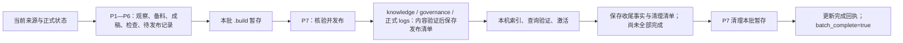

# 入库暂存与发布重构 SDD

状态：待评审，未实施。日期：2026-10-29。

本套文档按用户要求暂放 `repo/` 根目录并随仓提交，供对齐后实施。它是新的评审基线，替代[早期重构讨论方案](himate-knowledge-wifi-mp/docs-llm-wiki/Skill边界与状态记录重构方案.md)中“独立 maintain 负责常规清理”及“P7 前允许本批来源捕获写正式事件／证据”的取舍。早期正文保留供参照，不作为本轮实施依据。

## 1. 本轮核心约定

**P1—P6 只在 `.build` 保存本批中间产物；P7 统一发布已经检查的正式内容、状态和必要依据，完成适用检索收尾后清理本批不再需要的暂存。**

- 前六步被中断并换 session：正式资产不因该次执行改变；新 Workflow 使用新 operation，从正式状态重新开始，不接旧稿。
- 原 session 继续、同 Workflow 内明确返工仍可采用本次引用；scan 不调度旧流程恢复。
- 正式处理状态长期保存来源版本、关联卡和欠账，执行留痕不自动变成永久业务记录。
- P7 清理后的正常消费、结果读取和提交核验不能再依赖被删的 `.build`。
- 不给 ingest 加 maintain 清理节点，lint Workflow 保持只检查、只报告。
- P7 极窄落位中断自动修复和废弃暂存周期回收后置；现有安全保护继续保留。

## 2. 文档导航

| 文档 | 评审内容 |
|---|---|
| [需求](sdd-ingest-staging-requirements.md) | 用户场景、R01—R16、跨 session 重跑的保证范围与不覆盖项 |
| [设计](sdd-ingest-staging-design.md) | 暂存／正式目录、阶段职责、证据映射、成功发布与清理、兼容和影响面 |
| [任务](sdd-ingest-staging-tasks.md) | 依赖顺序、九 Skill 和文件修改范围、各任务完成条件 |
| [验证计划](sdd-ingest-staging-validation.md) | P1—P6 停点重跑、P7 发布后消费、清理隔离和兼容验收 |

## 3. 本次交付边界

本次只发布 SDD 和设计导航，没有修改 Skill、Workflow、机器契约、规则锁或安装副本，也没有清理真实运行目录。任务与验证条目均为计划，不能把此前测试成绩当作新方案已通过。

评审顺序建议为需求 → 设计 → 任务与验证。对齐后再按任务逐步实现；实际部署、宿主中断与真实 CI 另行记录验证范围。
