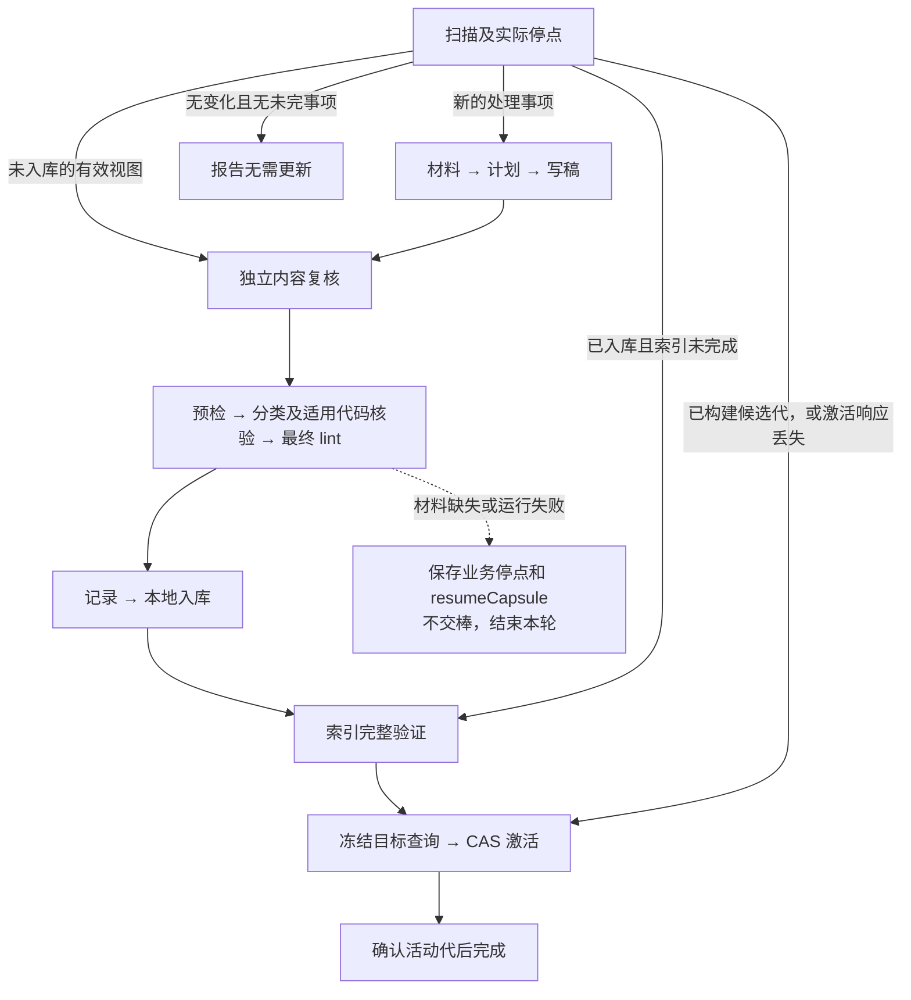

# ingest Workflow 的调用与验证

本目录是 OpenFlow Workflow 分发源码。`workflow.yaml` 使用官方节点格式，`layouts.yaml` 保存画布位置；部署时导入宿主的 `config/workflow-templates/hs-knowledge-ingest/`。Skill 另由宿主安装，节点 owner 对应实际可用的 `coder`、`reviewer` AI ID。

业务完成边界遵循[详细设计](../../../../himate-knowledge-wifi-mp/docs-llm-wiki/知识库详细设计.md)：内容批完成本地入库、完整索引验证、本批目标查询及活动代激活；首次 skip/defer/failed 等记录批保存记录后结束。Git 提交、CI 和合入由人后续处理。

## 阻断与续办



16 个业务节点均没有 `blocked → __end__`。缺材料、报告无效、运行异常、SSH 结果不明或修订无进展时，保存实际文件和诊断，只更新宿主允许的 `resumeCapsule`；没有满足出口条件就不交棒，结束本轮。OpenFlow 保留当前节点，运行态仍为 `active`，不能称为进入原生 `waiting`。Agent 不直接修改 `currentNode`、`batonHolder`、`flowState` 或 `recoveryContext`。

| 实际停点 | 继续位置及限制 |
|---|---|
| 未完成写入事务 | 先 recover 原事务，不能新建事务冒充恢复 |
| 未应用的有效完整视图 | resume 到 `review_content`；inspect 分类不代表独立复核完成 |
| 已 committed，尚无可用候选索引 | `resume_index`；保留原 operation 和 apply 事实 |
| 已有确切验证代与活动指针基线 | `resume_queries`；沿用 `generation_ref/expected_active` 和冻结查询 |
| 激活成功但响应丢失 | 对确切已通过报告执行 query-regression `verify`，再核实际 active；不重放旧 CAS |
| active 已由其他操作改变 | 保留冲突停点，不能把 expected_active 改成新指针强行激活 |
| 原件、代码、规则、基线或内容有实质变化 | 新操作准备新 scan/material/semantic plan/view，保留旧操作原字节 |
| 完整扫描后确实无需处理 | 直接结束，不新增 logs/ingest 记录 |

`source-scan status` 没有列出全部复核、索引和查询事实；恢复还须核对 OpenFlow capsule、原事务和确切输出。新操作不能复用旧操作的扫描和材料引用。v3 revise 的前置调用在节点中明确为新 scan → prepare → semantic plan → revise，并显式携带新 `context_ref`，随后重新独立复核。

## 产物交接

现有 Skill 契约的 `default_location.path` 不被所核实版本的 OpenFlow 契约 loader 采用。本 Workflow 保留 Skill 原样，在交接中显式提交：

```json
{
  "nodeId": "scan_sources",
  "exitId": "scanned",
  "artifacts": [{
    "id": "hs-knowledge-source-scan-result",
    "location": {
      "kind": "markdown_file",
      "path": "实际知识根相对路径/.build/operations/本次操作/handoffs/scan_sources/本次尝试/scan.md"
    }
  }]
}
```

上述是 `workflowCompletion` 的形状，示例路径须解析成真实路径。每次节点调用使用独立摘要，保留原 CLI 响应和业务引用；不让多个节点或重试覆盖一个 node-result.md。无变化出口不伪造 scan Skill 已要求的成功产物。

**宿主产物根须实际核对。**按渲染出的 `artifactLocationContext.projectRoot` 及绑定的 `artifactRoots` 验证摘要位置；它们可能与业务项目根不同。普通项目在所核实的 OpenFlow 版本中可能仍使用安装根校验产物。若知识根中的摘要不在宿主允许范围内，保存停点、报告根映射缺口；不在安装根另建业务目录，不用越界路径，不把 soft-record 警告当作产物已保存。此处需要真实宿主完成项目路径接入，模板不能代替宿主配置或源码修复。

## 离线回归

在项目根执行；使用实际 OpenFlow 检出目录，Node.js 及 OpenFlow 的 `yaml` 依赖须可用：

```text
node workflows/common/knowledge/hs-knowledge-ingest/tests/verify-openflow.cjs --openflow-root <OpenFlow绝对路径> --output-dir .scratch/ingest-workflow-checks
```

若依赖位于独立目录，可通过标准 `NODE_PATH` 提供，测试不会安装包或启动服务。测试在输出目录创建隔离的 Skill 元数据和 Workflow 安装布局，通过官方 registry、artifact loader、validator、loader、compiler、protocol guard、ToolHandoff 输入校验、严格 completion 校验及内存 runtime 检查本包。不会执行真实 ingest 或改写正式知识。

覆盖正常文档／混合批、16 节点保留停点、复核前中断、已入库的索引／查询续办、无变化 no-op、记录批、事务恢复、v3 修订前置、代码上下文传递、明确产物路径和宿主根不匹配的拒绝。查询重放和新操作参数的提示约束也做静态检查；这不等于执行了真实查询激活或代码修订。

本次验证的两个 OpenFlow 版本为上游 `715d203ed2512fa93256b8b1f35e33dbc4b36b52` 和用户 fork `1901a463efca222542a4634d7ce50c7b244b2bab`。版本更新后应重跑，不能据本次结果推断将来的宿主行为。

项目原 `evals/validate_design.py` 写死了旧的 16 节点边表，包括错误的 blocked 终点和旧恢复路由，不能作为修订图的有效检查。按本次“仅改 Workflow 文件夹”的范围未修改它；旧 Workflow 测试实际为 19 通过、1 跳过、3 失败，失败来自旧边表比较及查找已删除的 blocked 出口。此限制明确保留，新图使用本目录检查验证。其他 Skill 的业务校验没有放宽。
